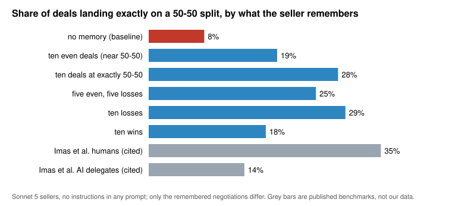

# Agents learning norms

**Can an AI negotiator pick up a social norm from experience instead of instructions?**

People haggling over a used car split the surplus exactly 50-50 about 35% of the time. When
they write a prompt and let an AI agent haggle for them, that drops to about 14%
(Imas, Lee & Misra, 2025, *Agentic Interactions*). We tested whether the missing
norm comes back if, instead of instructing the agent, we give it **memories**: ten transcripts
of past negotiations it supposedly took part in. Nothing in its prompt says to be fair.

This repository contains everything from that project, July–August 2026:

- **all of the data**: every saved run (nearly 10,000 records across 72 files: negotiations,
  the memories each agent carried, playbooks and probe answers), including the transcript bank
  the memories were drawn from;
- **our results**, regenerated from that data by one script that needs no API key;
- **our interpretation**, in [`my-takeaways.md`](my-takeaways.md);
- **the exact code** that produced the data, so you can rerun any part with your own
  Anthropic API key.

## The headline result



| the seller remembers… | deals at exactly 50-50 |
|---|---:|
| nothing | 8% |
| ten near-even deals | 19% |
| ten deals at exactly 50-50 | 28% |
| ten losses | 29% |
| ten wins | 18% |
| *people negotiating directly (Imas et al.)* | *35%* |
| *AI agents run on people's prompts (Imas et al.)* | *14%* |

Memory alone, with no instruction to be fair, roughly triples how often Sonnet 5 sellers land
on the even split, taking them most of the way to the human rate. Why *losses* work better
than *wins*, what happens when the experience is compressed into a written playbook, and why
the posted price range turns out to matter so much: all of that is in
**[my-takeaways.md](my-takeaways.md)**.

## Where to look

| if you want… | go to |
|---|---|
| our interpretation | [`my-takeaways.md`](my-takeaways.md) |
| every results table | [`results/RESULTS.md`](results/RESULTS.md) (CSV versions alongside) |
| what each data field means | [`experiments/DATA.md`](experiments/DATA.md) |
| to read actual negotiations | any `experiments/*/data/*.jsonl` file; each line is one negotiation with its full transcript |
| the exact memories each agent saw | `experiments/arena/data/*.agents.jsonl` (`block` field) |

## The design in one paragraph

Each test negotiation is Imas's used 2020 Camry: the seller can get $18,000 elsewhere, the buyer
$22,000, so $4,000 of surplus is on the table. Every seller agent carries ten past
negotiations over *other* goods (a motorcycle, an espresso machine, a sailboat…), drawn from a
bank of model-vs-model negotiations in which **only the counterparty was given a personality**
and the agent's own past self was always neutral. Conditions differ only in the mix of
memories: all even, half and half, all losses, all wins, or all exactly 50-50. Each condition
has 20 sellers, each negotiating six times. In Arm B, the seller instead writes a playbook from
its memories and a fresh agent negotiates from the playbook alone.

## Repository layout

```
my-takeaways.md        our interpretation of the results
results/               tables and figure, generated by analysis/make_results.py
analysis/              the script that builds results/ from the saved data
experiments/
  DATA.md              codebook for every data file
  pool/                builds the transcript bank (the memories)       + data/
  arena/               the main experiment: Arm A, Arm B, probes        + data/
  firstmover/          no-memory baselines and model comparisons        + data/
  phase1/              first pipeline tests (30 July)                   + data/
tests/                 checks that the data reproduces the reported results
```

## Reproduce our results (no API key)

Needs only Python 3.9 or newer; no packages.

```bash
python analysis/make_results.py      # rewrites results/ from experiments/*/data/
```

The output is deterministic. `make check` regenerates it and fails if anything differs from the
committed `results/`.

## Rerun the experiments (your own API key)

The experiments call Anthropic's API (`claude-sonnet-5`, with `claude-haiku-4-5` for the model
comparison). You supply the key and pay for usage; nothing here contains ours.

```bash
uv sync                                   # or: pip install anthropic matplotlib pandas
cp .env.example .env                      # then put your key in .env
```

Free, no key needed:

```bash
uv run python -m experiments.arena.verify      # structural checks on the arena design
```

The main steps, in the order we ran them (every command is resumable):

```bash
# 1. Build the transcript bank the memories are drawn from
uv run python -m experiments.pool.generate --batch first     # ~24 negotiations; read them first
uv run python -m experiments.pool.generate --batch full
uv run python -m experiments.pool.topup --target 6           # fill thin cells
uv run python -m experiments.pool.promote                    # fold development runs into the bank

# 2. No-memory baselines
uv run python -m experiments.firstmover.run2x2 --n 4

# 3. The main experiment
uv run python -m experiments.arena.run --preview             # prints panels and token counts
uv run python -m experiments.arena.run --arm A
uv run python -m experiments.arena.run --arm B
uv run python -m experiments.arena.probe --file <your Arm A file>
```

Our notes estimated about **$0.70 per Arm A negotiation** and **$0.45 per Arm B negotiation**,
dominated by the ten-transcript memory each agent carries. A full arm is 600 negotiations.
Every script's docstring explains its options; `--help` lists them.

Two things to know before rerunning:

- **New runs write new, timestamped files** next to ours in `experiments/*/data/`. A few
  scripts use fixed filenames instead: `pool.interior`, `firstmover.extreme*` and
  `firstmover.tails` append to ours, and `pool.promote` rewrites the two `pool_*promoted*`
  files. Copy the originals first if you want to compare.
- **Your memories will not be identical to ours.** Histories are drawn from the bank, and the
  bank grew after our main runs. The exact memories our agents saw are preserved in
  `experiments/arena/data/*.agents.jsonl`.

## What is not included

Our private working notes (replaced by `my-takeaways.md`), copies of the papers we read, and
machine-specific scripts. Everything the analysis or the code reads is here.

## References

- Imas, A., Lee, K., & Misra, S. (2025). *Agentic Interactions.* The used-car game, its
  wording, and the 34.7% / 14.3% benchmarks come from this paper.
- Bordalo, P., Gennaioli, N., Lanzani, G., & Shleifer, A. (2026). *A Cognitive Theory of
  Reasoning and Choice.* The idea that recognising the kind of problem comes before solving it.

## License and citation

Code: MIT. Data and write-up: CC BY 4.0. If you use either, please cite this repository (see
[`CITATION.cff`](CITATION.cff)).
