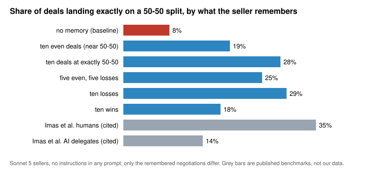

# Results

Generated by `python analysis/make_results.py` from the saved runs in `experiments/*/data/`. Do not edit by hand.

`seller share` = fraction of the surplus the seller captured (0.5 = even split). `focal` = deal landed exactly on 0.5.

## 1. What the seller remembers vs. how the deal ends

| seller remembers | n | mean seller share | focal | deals below 0.40 |
|---|---:|---:|---:|---:|
| no memory (baseline) | 24 | 0.409 | 8% | 38% |
| ten even deals (near 50-50) | 120 | 0.461 | 19% | 10% |
| ten deals at exactly 50-50 | 120 | 0.464 | 28% | 7% |
| five even, five losses | 120 | 0.472 | 25% | 2% |
| ten losses | 119 | 0.476 | 29% | 4% |
| ten wins | 120 | 0.463 | 18% | 8% |
| *Imas et al. humans (cited)* | | | *35%* | |
| *Imas et al. AI delegates (cited)* | | | *14%* | |

## 2. Carrying the history (Arm A) vs. a playbook written from it (Arm B)

| arena | A n | A mean | A focal | B n | B mean | B focal |
|---|---:|---:|---:|---:|---:|---:|
| ten even deals (near 50-50) | 120 | 0.461 | 19% | 120 | 0.477 | 22% |
| ten deals at exactly 50-50 | 120 | 0.464 | 28% | 120 | 0.473 | 29% |
| five even, five losses | 120 | 0.472 | 25% | 120 | 0.470 | 22% |
| ten losses | 119 | 0.476 | 29% | 120 | 0.480 | 22% |
| ten wins | 120 | 0.463 | 18% | 120 | 0.486 | 32% |
| pooled: original four arenas | 479 | 0.468 | 23% | 480 | 0.478 | 25% |
| pooled: all five arenas | 599 | 0.467 | 24% | 600 | 0.477 | 26% |

## 3. Removing the posted price range

| cell | seller remembers | n | mean | focal |
|---|---|---:|---:|---:|
| range posted in memory and in the arena | ten even deals (near 50-50) | 120 | 0.461 | 19% |
| range posted in memory and in the arena | ten deals at exactly 50-50 | 120 | 0.464 | 28% |
| range posted in memory and in the arena | five even, five losses | 120 | 0.472 | 25% |
| range posted in memory and in the arena | ten losses | 119 | 0.476 | 29% |
| range posted in memory and in the arena | ten wins | 120 | 0.463 | 18% |
| range posted in memory, removed from the arena | ten even deals (near 50-50) | 120 | 0.598 | 10% |
| range posted in memory, removed from the arena | ten deals at exactly 50-50 | 120 | 0.585 | 14% |
| range posted in memory, removed from the arena | five even, five losses | 120 | 0.617 | 6% |
| range posted in memory, removed from the arena | ten losses | 120 | 0.629 | 6% |
| range posted in memory, removed from the arena | ten wins | 120 | 0.561 | 10% |
| range removed from memory and from the arena | ten even deals (near 50-50) | 120 | 0.409 | 10% |
| range removed from memory and from the arena | five even, five losses | 120 | 0.417 | 10% |
| range removed from memory and from the arena | ten losses | 119 | 0.395 | 10% |
| range removed from memory and from the arena | ten wins | 120 | 0.419 | 10% |

## 4. Both sides briefed (pool interior grid)

| buyer brief | seller brief | n | mean | sd | focal |
|---|---|---:|---:|---:|---:|
| fair | fair | 18 | 0.485 | 0.029 | 78% |
| fair | shark | 18 | 0.590 | 0.04 | 6% |
| fair | pushover | 18 | 0.439 | 0.055 | 22% |
| shark | fair | 18 | 0.248 | 0.073 | 0% |
| shark | shark | 18 | 0.384 | 0.093 | 17% |
| shark | pushover | 18 | 0.184 | 0.08 | 0% |
| pushover | fair | 18 | 0.494 | 0.072 | 28% |
| pushover | shark | 18 | 0.628 | 0.049 | 0% |
| pushover | pushover | 18 | 0.388 | 0.07 | 0% |

## 5. No-memory baselines by model and reasoning

| cell | opener | n | mean | focal | below 0.40 |
|---|---|---:|---:|---:|---:|
| sonnet-think | buyer | 24 | 0.409 | 8% | 38% |
| sonnet-think | seller | 24 | 0.484 | 21% | 0% |
| sonnet-nothink | buyer | 47 | 0.403 | 6% | 45% |
| sonnet-nothink | seller | 40 | 0.452 | 5% | 8% |
| haiku-think | buyer | 48 | 0.498 | 12% | 8% |
| haiku-think | seller | 48 | 0.532 | 12% | 8% |
| haiku-nothink | buyer | 23 | 0.516 | 9% | 13% |
| haiku-nothink | seller | 24 | 0.508 | 12% | 21% |

## 6. The transcript bank histories are drawn from

| bank | past-you role | outcome | transcripts |
|---|---|---|---:|
| range hidden | buyer | even | 162 |
| range hidden | buyer | favourable | 135 |
| range hidden | buyer | unfavourable | 100 |
| range hidden | seller | even | 191 |
| range hidden | seller | favourable | 149 |
| range hidden | seller | unfavourable | 173 |
| range posted | buyer | even | 167 |
| range posted | buyer | favourable | 185 |
| range posted | buyer | unfavourable | 88 |
| range posted | seller | even | 623 |
| range posted | seller | favourable | 235 |
| range posted | seller | unfavourable | 129 |
